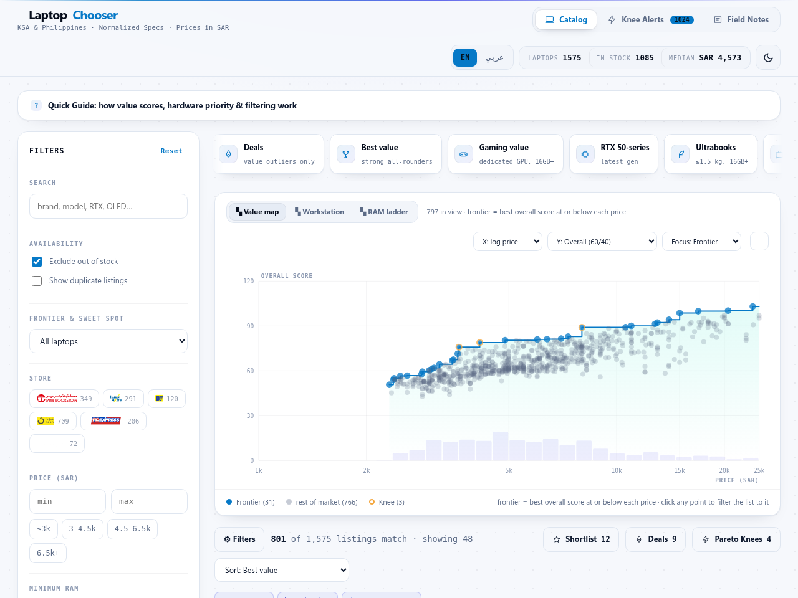

# Laptop Chooser

Compare every laptop across six stores in one normalized catalog: benchmark-calibrated performance/value scores, a 25-peer
typical-price model, deal alerts, and Pareto-frontier sweet-spot detection.



**Live demo:** https://laptop-chooser.holistic.workers.dev

## Features

- **Best-value ranking** — measured PassMark/Notebookcheck benchmarks per chip, affine-regularized value score (see [`docs/scoring.md`](docs/scoring.md))
- **🔥 Deal alerts** — listings delivering ≥1.5× the value of their 25 closest spec peers
- **⚡ Pareto knees** — max-efficiency inflection points before diminishing returns, with price-drop / hike tracking
- **Market charts** — value map, workstation (RAM+CPU+GPU), and RAM-ladder frontiers, all click-to-filter
- **Cross-store dedupe** — identical configs fold into one card with per-store offers
- **Data-quality layer** — ⚠ unusually-cheap badges, seller open-box warnings, hide filters
- **Shortlist with historical lows** — ★ tracking, lowest-ever badges, price trends
- **Light/dark themes**
- **Compare tray** — up to 3 laptops side-by-side with per-row best highlighted
- **📱 Phone Chooser** — same idea for smartphones (Jarir + eXtra + GreenTelcom + Ichiban): AnTuTu-based
  chip scores, camera/battery/display quality index, value per SAR —
  separate page at `viewer/phones.html` (`/phones.html` when deployed)

## Tech stack

Python scrapers (requests, SQLite/JSONL) · single-file HTML/JS viewer (hand-rolled SVG, no framework, no build step) · Cloudflare Workers static hosting.

## Run it

```bash
pip install requests

# Fastest: open the catalog (data snapshot ships in viewer/laptops.js)
xdg-open viewer/index.html

# Or serve locally with auto-refresh when the snapshot is older than 24h
python3 app.py

# Refresh the snapshot (re-fetches only stale pages; daily via cron)
./update.sh
./update.sh --force   # ignore freshness check

# Ship it: one self-contained HTML file on a Cloudflare Worker
python3 build_worker.py
cd deploy && npx wrangler deploy
```

`data/` (raw scrapes, price history) is generated locally by the scrapers and is
**not versioned** — clone, open the viewer, and it works. See
[`docs/scoring.md`](docs/scoring.md) and [`docs/scoring_rationale.md`](docs/scoring_rationale.md)
for methodology.

## Layout

```
scraper/       # per-store scrapers, normalize.py, benchmarks, ratings, dedupe, sanity, moat
               #  + jarir/extra_phones_scraper.py, normalize_phones.py, phone_benchmarks.py
viewer/        # the chooser: index.html + generated laptops.js payload + store logos
               #  + phones.html + generated phones.js payload (separate phone catalog)
app.py         # local launcher: freshness check + background refresh + static server
update.sh      # refresh scrapers + normalize (skipped when snapshot is fresh)
build_worker.py# packages viewer/ into deploy/public/index.html (single file)
deploy/        # generated Worker output (git-ignored; rebuild with build_worker.py)
reports/       # generated pareto / scrape-progress snapshots
docs/          # screenshot, scoring methodology, scoring rationale
data/          # local-only generated datasets (git-ignored, never served)
dev/           # local-only review/debug pages (git-ignored, never served)
cache/ logs/   # fetcher cache, cron output (git-ignored)
```

## Data & privacy boundary

Only `viewer/` is ever served (sanitized payload — `scraper/moat.py` strips
derivation such as spec-sheet source URLs and teardown citations, and summarizes
price history to a sparkline). Raw per-store scrapes, the full day-by-day price
series, and debug review pages stay on the operator's machine and are excluded
from version control. Please respect the stores' terms of service when scraping.
